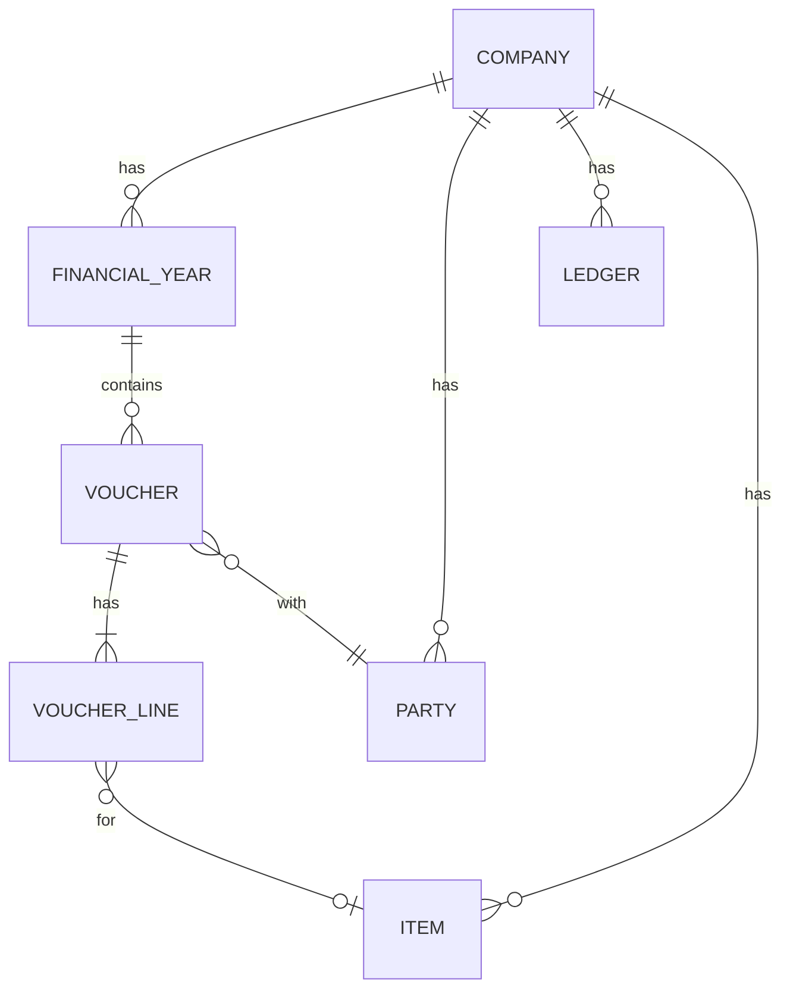

# Shared domain model

Unified entities reconciled across all apps. Our names only.

## Entities
| Entity | Purpose | Source apps | Notes |
| --- | --- | --- | --- |

## Sync-readiness conventions
- UUID primary keys, `created_at`, `updated_at`, `version`, `deleted` (soft delete)
- Change log table per company for sync
