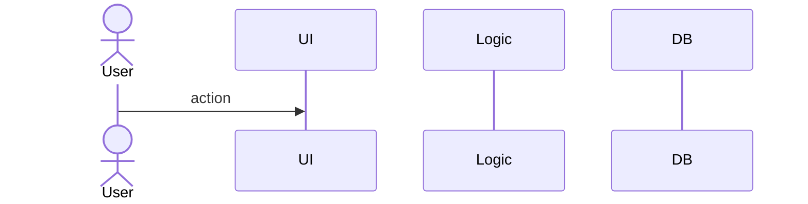
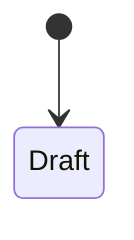

# <Workflow name>

- Capability IDs:
- Trigger:
- Actors / roles:
- Captures: `_raw/<app>/captures/<workflow-slug>/`

## Steps
1.

## Sequence

## Data changes
| Entity | Create / update / delete | Fields | Evidence |
| --- | --- | --- | --- |

## States (if any)

## Errors and edge cases
-

## Rules used
- link to `../05-business-rules/<area>.md#<rule>`
